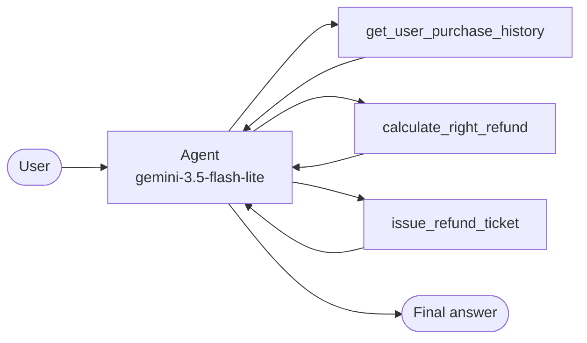

# Refund Agent

Refund agent that looks up purchase history, verifies the 30-day return policy, calculates the refund amount, and issues a ticket. Evaluated with 7 DeepEval metrics across trace and single-turn dimensions.

---

## Results

**Table 1 — Metric scores before and after fixes**

| Metric | Type | Threshold | Before | After | Status |
|---|---|---|---|---|---|
| Task Completion | Trace | 0.80 | 0.00 | 0.80 | PASS |
| Step Efficiency | Trace | 0.80 | 0.50 | 1.00 | PASS |
| Plan Quality | Trace | 0.80 | TODO | 1.00 | PASS |
| Plan Adherence | Trace | 0.80 | TODO | 1.00 | PASS |
| Tool Correctness | Single-turn | 0.90 | TODO | 1.00 | PASS |
| Argument Correctness | Single-turn | 0.80 | 0.50 | 1.00 | PASS |
| Answer Correctness [GEval] | Single-turn | 0.80 | TODO | 1.00 | PASS |

> Before scores for Plan Quality, Plan Adherence, Tool Correctness, and Answer Correctness were not captured in the first run. Those 4 metrics were passing before the fix work began; TODO marks unknown numeric values.

**Table 2 — Summary**

| Item | Calculation | Result |
|---|---|---|
| Metrics passing (after) | 7 / 7 | 100% |
| Metrics passing (before) | 4 / 7 | 57% |
| Avg score before (known 3 failing) | (0.00 + 0.50 + 0.50) / 3 | 0.33 |
| Avg score after (all 7) | (0.80 + 1.00 + 1.00 + 1.00 + 1.00 + 1.00 + 1.00) / 7 | 0.97 |
| Tool calls per task | 4 → 3 | −1 call |
| Eval runs for stability | 3 runs | Scores stable |

**3 failing metrics fixed without changing any threshold.**

---

## How it works



**Tools**

| Tool | Input | Output |
|---|---|---|
| `get_user_purchase_history` | `user: str` | Dict of items → `{price, date}` |
| `calculate_right_refund` | `user: str`, `items: list[PurchaseItem]` | `{purchase_date, today_date, days_since_purchase, within_30_day_window, refund_amount, eligible, eligible_items, ineligible_items}` |
| `issue_refund_ticket` | `user: str`, `refund_amount: int` | `{status, ticket_id, user, refund_amount, message}` |

The agent is built with `langchain.agents.create_agent` using `gemini-3.5-flash-lite` and an `InMemorySaver` checkpointer. The system prompt specifies a 4-step plan and mandates that the final answer begins with "A refund was issued." or "A refund was not issued." and states purchase date, today's date, days elapsed, 30-day window verification, refund amount, and ticket ID. Each tool is decorated with `@observe(type="tool")` and the agent wrapper with `@observe(type="agent")`; `CallbackHandler()` from DeepEval's LangChain integration connects callbacks to the trace context, and `update_current_trace(output=...)` sets the final answer text on the trace so the LLM judge grades the clean string rather than the raw LangGraph state dict.

---

## Sample run

```
Input:  I am user123, I would like a refund for the book and the pen

Output: A refund was issued. The book was purchased on 2026-11-05 and the
        pen on 2026-11-03, today is 2026-11-15, which is 10 days for the
        book and 12 days for the pen, verified within the 30-day refund
        window. The calculated refund amount is $30 and Refund ticket
        REF-user123-200697 has been issued.
```

---

## What I fixed

**Step Efficiency 0.50 → 1.00**
- Problem: `StepEfficiencyMetric` scored 0.50 because the agent made 4 tool calls.
- Cause: A separate `get_today_date` tool existed as its own agent-facing call.
- Fix: Removed `get_today_date`; moved `date.today()` lookup inside `calculate_right_refund`. Tool sequence reduced to `get_user_purchase_history → calculate_right_refund → issue_refund_ticket` (3 calls).
- Impact: Step Efficiency 0.50 → 1.00.

**Argument Correctness 0.50 → 1.00**
- Problem: `ArgumentCorrectnessMetric` gave "no" verdicts on tool calls with empty arguments `{}`.
- Cause: `get_today_date` took no arguments; every verdict for it was unsupported.
- Fix: Removed the zero-argument tool. Also stripped the optional `reason` field from `issue_refund_ticket` (signature tightened to `user: str, refund_amount: int`), so the actual call dict exactly matches `expected_tools`.
- Impact: Argument Correctness 0.50 → 1.00. Tool Correctness also stabilised at 1.00 (was dropping to 0.89 when the extra field caused dict mismatch against `expected_tools`).

**Task Completion 0.00 → 0.80**
- Problem: `TaskCompletionMetric` scored 0.00 because the judge saw the raw LangGraph state dict as the output, and the response text lacked required confirmation elements.
- Cause: `update_current_trace()` was not called after `agent.invoke()`, so the trace output was `{'messages': [...]}` instead of the final answer string. The system prompt also did not enforce explicit mention of dates, days elapsed, and 30-day window.
- Fix: Added `update_current_trace(output=actual_output)` immediately after extracting `response["structured_response"].answer`. Updated system prompt to mandate the 5 required elements in the final answer. Added Step 4 to the plan so the LLM judge sees a complete plan-to-execution match.
- Impact: Task Completion 0.00 → 0.80. Plan Quality also moved from 0.50 → 1.00 (the judge now finds unambiguous, concrete steps).

---

## Run it

**Install**
```bash
git clone https://github.com/tilakchow/RefundAgent.git
cd RefundAgent
uv sync
```

**Environment variables** — create `.env` in the project root:
```
GEMINI_API_KEY=your_google_ai_studio_key_here
```

**Run the agent (interactive)**
```bash
cd agent
uv run python agent.py
```

**Run all 7 evaluations**
```bash
uv run python evaluations/eval_all.py
```

The script pauses 40 seconds between the trace-metric phase and the single-turn phase to stay within the Gemini Free Tier limit (15 req/min). Full run takes ~2–4 minutes.

---

## Project structure

```
RefundAgent/
├── agent/
│   ├── agent.py          # Creates agent; invoke_agent() and run_conversation()
│   ├── data.py           # In-memory purchase store (mock DB, 10 users)
│   ├── models.py         # ChatGoogleGenerativeAI setup (gemini-3.5-flash-lite)
│   ├── objects.py        # Pydantic models: Answer, PurchaseItem
│   ├── prompts.py        # System prompt: 4-step plan + output format rules
│   └── tools.py          # 3 @tool + @observe functions
├── evaluations/
│   ├── dataset.py        # 7 EvaluationDataset goldens
│   ├── eval_all.py       # Runs all 7 metrics; prints results table
│   ├── model.py          # RobustGeminiModel: GeminiModel + 429/503 backoff
│   ├── answer_correctness.py    # Standalone GEval runner
│   ├── argument_correctness.py  # Standalone ArgumentCorrectnessMetric runner
│   ├── plan_adherence.py        # Standalone PlanAdherenceMetric runner
│   ├── plan_quality.py          # Standalone PlanQualityMetric runner
│   ├── step_efficiency.py       # Standalone StepEfficiencyMetric runner
│   ├── task_completion.py       # Standalone TaskCompletionMetric runner
│   └── tool_correctness.py      # Standalone ToolCorrectnessMetric runner
└── pyproject.toml        # Dependencies: deepeval ≥4.3.4, langchain ≥1.4.9
```

---

## Limitations

- **Small test set.** 7 goldens cover the main paths (refund granted, denied, invalid user, partial eligibility, item not purchased). Edge cases and multi-turn flows are not evaluated.
- **LLM-judge variance.** Gemini-based judges are non-deterministic. Task Completion scored exactly at threshold (0.80); a different judge run could score it slightly lower. Three runs were used to verify stability, not a statistical guarantee.
- **Mock data and tools.** `agent/data.py` is a hard-coded Python dict. `issue_refund_ticket` generates a UUID-based ticket ID with no backend persistence. No real database or order management system is involved.
- **Free Tier rate limits.** The eval script requires deliberate pauses between API calls. Running `eval_all.py` on CI without a paid API key will hit quota errors without added throttling.

---

**Author:** Tilak Chowdary · [LinkedIn](https://www.linkedin.com/in/tilakchowdary05) · [GitHub](https://github.com/tilakchow)
