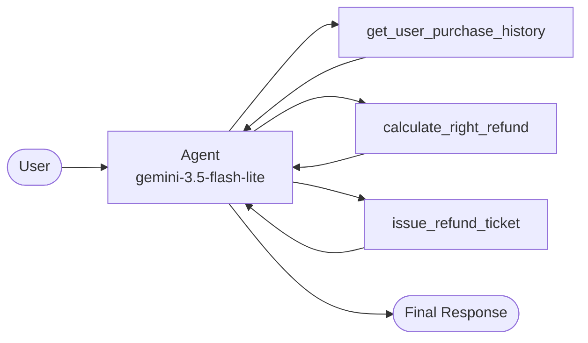

# Refund Agent

An LLM agent that handles customer refund requests by verifying purchase history, checking a 30-day return policy, and issuing refund tickets — evaluated end-to-end with DeepEval.


---

## Overview

Customer support agents spend a lot of time on routine refund requests that follow predictable rules. This project builds an agentic workflow around that use case:

1. The agent receives a natural-language refund request and identifies the customer's username.
2. It looks up their purchase history from an in-memory store.
3. It calculates whether each requested item is eligible for a refund (purchased within 30 days).
4. If eligible, it generates a refund ticket with a unique ID and reports the outcome to the customer.

The focus of the project is as much on **evaluation** as on the agent itself. All 7 DeepEval metrics — covering plan quality, tool use, argument correctness, and answer quality — pass at their defined thresholds.

---

## Demo

**User input:**
```
I am user123, I would like a refund for the book and the pen
```

**Agent response:**
```
A refund was issued. The book was purchased on 2026-11-05 and the pen on
2026-11-03, today is 2026-11-15, which is 10 days for the book and 12 days
for the pen, verified within the 30-day refund window. The calculated refund
amount is $30 and Refund ticket REF-user123-200697 has been issued.
```

---

## Architecture



The agent always follows this 3-tool sequence for refund requests (fewer calls for non-refund queries):

| Tool | Inputs | Output | Purpose |
|---|---|---|---|
| `get_user_purchase_history` | `user: str` | Dict of items → {price, date} | Fetches the customer's purchase records from the data store |
| `calculate_right_refund` | `user: str`, `items: list[PurchaseItem]` | Eligibility details, dates, refund amount | Checks today's date internally, verifies the 30-day window, and sums eligible items |
| `issue_refund_ticket` | `user: str`, `refund_amount: int` | Ticket ID and confirmation | Generates a unique `REF-{user}-{hex}` ticket and returns it |

---

## Tech Stack

| Component | Technology |
|---|---|
| LLM (agent) | `gemini-3.5-flash-lite` via `langchain-google-genai >= 4.4.3` |
| LLM (evaluator) | `gemini-3.5-flash-lite` via `deepeval` GeminiModel |
| Agent framework | `langchain >= 1.4.9` + `langgraph` (InMemorySaver checkpointer) |
| Evaluation library | `deepeval >= 4.3.4` |
| Tracing | DeepEval `@observe` decorators + LangChain `CallbackHandler` |
| Structured output | Pydantic `BaseModel` (`Answer`, `PurchaseItem`) |
| Env / secrets | `python-dotenv` |
| Package manager | `uv` |
| Python | 3.14 |

---

## Project Structure

```
RefundAgent/
├── agent/
│   ├── agent.py          # Creates the LangChain agent; defines invoke_agent() and run_conversation()
│   ├── data.py           # In-memory user purchase data (mock database)
│   ├── models.py         # Instantiates ChatGoogleGenerativeAI (gemini-3.5-flash-lite)
│   ├── objects.py        # Pydantic models: Answer (structured response), PurchaseItem
│   ├── prompts.py        # System prompt: 4-step plan + output formatting rules
│   └── tools.py          # The 3 LangChain tools, each decorated with @observe
├── evaluations/
│   ├── dataset.py        # 7 EvaluationDataset goldens with inputs, expected outputs, expected tools
│   ├── eval_all.py       # Runs all 7 metrics in one script; prints a results table
│   ├── model.py          # RobustGeminiModel: GeminiModel subclass with retry/backoff for 429/503
│   ├── answer_correctness.py    # Standalone runner for GEval Answer Correctness
│   ├── argument_correctness.py  # Standalone runner for ArgumentCorrectnessMetric
│   ├── plan_adherence.py        # Standalone runner for PlanAdherenceMetric
│   ├── plan_quality.py          # Standalone runner for PlanQualityMetric
│   ├── step_efficiency.py       # Standalone runner for StepEfficiencyMetric
│   ├── task_completion.py       # Standalone runner for TaskCompletionMetric
│   └── tool_correctness.py      # Standalone runner for ToolCorrectnessMetric
├── pyproject.toml        # Project metadata and dependencies (uv)
├── .python-version       # Pins Python 3.14
├── .env                  # Local secrets (not committed)
└── README.md
```

---

## Getting Started

### Prerequisites

- Python 3.14
- [`uv`](https://docs.astral.sh/uv/) package manager
- A [Google AI Studio](https://aistudio.google.com/) API key

### Installation

```bash
git clone <your-repo-url>
cd RefundAgent

# Create virtual environment and install dependencies
uv sync
```

### Environment Variables

Create a `.env` file in the project root:

```env
GEMINI_API_KEY=your_google_ai_studio_key_here
```

> The `GROQ_API_KEY` variable is also read from `.env` but is not used by the current agent or evaluations — it was used during development with an alternate model.

### Running the Agent

```bash
# Interactive conversation loop
cd agent
uv run python agent.py
```

The agent starts a conversation, processes your refund request, and exits when the interaction is complete.

---

## Evaluation 📊

The agent is evaluated using [DeepEval](https://docs.confident-ai.com/) across **7 metrics** covering both trace-level (agentic) and single-turn behaviour.

### Latest Results

| Metric | Type | What it measures | Threshold | Score | Status |
|---|---|---|---|---|---|
| Task Completion | Trace | Did the agent complete the user's request correctly per the task spec? | 0.80 | **0.80** | ✅ PASS |
| Step Efficiency | Trace | Did the agent use the minimum necessary tool calls? | 0.80 | **1.00** | ✅ PASS |
| Plan Quality | Trace | Does the agent's plan have clear, actionable, non-ambiguous steps? | 0.80 | **1.00** | ✅ PASS |
| Plan Adherence | Trace | Did the agent follow its stated plan? | 0.80 | **1.00** | ✅ PASS |
| Tool Correctness | Single-turn | Were the right tools called with the right arguments? | 0.90 | **1.00** | ✅ PASS |
| Argument Correctness | Single-turn | Were all tool arguments grounded in the user's request? | 0.80 | **1.00** | ✅ PASS |
| Answer Correctness [GEval] | Single-turn | Does the final answer match the expected logical conclusion? | 0.80 | **1.00** | ✅ PASS |

**Overall: 7/7 metrics passed.**

> Scores from the most recent run on 2026-11-15 using `gemini-3.5-flash-lite` as the judge model.

### Running Evaluations

```bash
# Run all 7 metrics at once (recommended)
cd RefundAgent
uv run python evaluations/eval_all.py
```

Individual metric scripts are also available (e.g. `evaluations/step_efficiency.py`) for faster iteration on a specific metric.

**Note on rate limits:** `eval_all.py` includes a 40-second pause between the trace-metric phase and the single-turn metric phase to stay within the Gemini Free Tier limit of 15 requests per minute. Expect the full run to take 2–4 minutes.

### How Tracing Works

Each tool is decorated with `@observe(type="tool")`, and the agent wrapper uses `@observe(type="agent")`. During evaluation, `CallbackHandler()` from DeepEval's LangChain integration is passed to the agent's `config`, which connects LangChain's callback events to DeepEval's trace context. After each invocation, `update_current_trace(output=actual_output)` sets the trace's output to the clean text answer (rather than the raw LangGraph state dict), which is what the LLM judge actually grades.

---

## Key Design Decisions

- **Date lookup moved inside `calculate_right_refund`.** An earlier version had a separate `get_today_date` tool. That added an unnecessary tool call and penalised Step Efficiency. Moving the date logic inside the tool reduced the sequence from 4 calls to 3 and brought Step Efficiency from 0.50 to 1.00.

- **`issue_refund_ticket` takes exactly two arguments.** The tool signature was tightened to `(user: str, refund_amount: int)` with no optional extras. When the LLM passed an additional `reason` field, Tool Correctness dropped to 0.89 because the argument dictionaries no longer matched the expected tools exactly.

- **Zero-argument tool calls are penalised by Argument Correctness.** The metric checks whether each argument is grounded in the user's input. Tools called with empty `{}` get a "no" verdict for every argument, pulling the score below threshold. The system prompt now explicitly forbids empty calls.

- **The final answer must state all 5 details explicitly for Task Completion.** The LLM judge for Task Completion checks whether the agent confirmed the refund outcome. Without a structured statement ("A refund was issued. ... within the 30-day window ... ticket REF-..."), the judge scored 0. The system prompt enforces the required format.

- **LLM-as-judge metrics vary between runs.** Free Tier rate limits and non-deterministic generation mean scores can shift slightly across runs. We ran evaluations 2–3 times to confirm stability before treating a score as reliable.

---

## Limitations

- **Small test set.** The evaluation dataset has 7 goldens covering a handful of edge cases. It is enough to validate the current tool flow but not enough to detect subtle failure modes.
- **Mock data.** `agent/data.py` is an in-memory Python dict. The agent has no connection to a real database or order management system.
- **LLM-judge variance.** Gemini-based judges are non-deterministic. A metric that scores 0.80 on one run may score 0.75 or 0.90 on another. Thresholds are set with this in mind, but marginal passes (like Task Completion at 0.80) should be treated with some caution.
- **Single-turn evaluation only.** The agent supports multi-turn conversation (see the `conversation` flag in `Answer`), but the evaluation dataset only tests single-turn interactions.
- **Free Tier rate limits.** Running the full eval suite requires waiting between API calls. This makes CI integration slow without a paid API key.

---

## Future Improvements

- **More test cases and edge cases.** Add goldens for multi-turn conversations, partial refunds (some items eligible, some not), and ambiguous usernames.
- **CI integration.** Run `eval_all.py` on every pull request with a threshold gate so regressions are caught automatically.
- **Real data backend.** Replace `data.py` with a database query or REST API call to make the agent usable with actual order data.
- **Guardrails.** Add input validation to reject clearly malformed requests (e.g. empty username, negative refund amounts) before they reach the LLM.
- **Multi-turn evaluation.** Extend the dataset with multi-turn goldens and use DeepEval's conversational test case support to evaluate back-and-forth interactions.

---

## License

MIT

## Author

**Tilak Chowdary**
- GitHub: [TODO: add GitHub profile URL]
- LinkedIn: [TODO: add LinkedIn profile URL]
